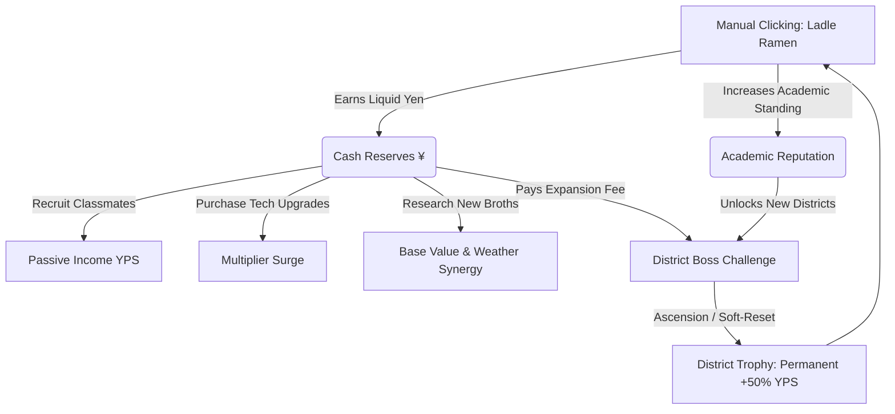

# 🍜 Ramen Nights & Budget Bites
### *Applied Market Dynamics through Culinary Entrepreneurship*

[](https://vitejs.dev/)
[](https://react.dev/)
[](https://www.typescriptlang.org/)
[](https://tailwindcss.com/)
[](https://web.dev/progressive-web-apps/)
[](LICENSE)

```
  ____                               _   _ _       _     _          
 |  _ \ __ _ _ __ ___   ___ _ __   | \ | (_) __ _| |__ | |_ ___    
 | |_) / _` | '_ ` _ \ / _ \ '_ \  |  \| | |/ _` | '_ \| __/ __|   
 |  _ < (_| | | | | | |  __/ | | | | |\  | | (_| | | | | |_\__ \   
 |_| \_\__,_|_| |_| |_|\___|_| |_| |_| \_|_|\__, |_| |_|\__|___/   
          &  B U D G E T   B I T E S         |___/                  
       ~ Tokyo Hodai University : Economics 301 Capstone ~         
```

> *"Listen up, slacker. Welcome to Economics 301: Applied Market Dynamics through Culinary Entrepreneurship. You’ve got a rickety wooden pushcart, a single brass ladle, and a partner from Engineering who survives exclusively on caffeine and dreams. If you can't pay your rent, keep your staff fed, and graduate with Summa Cum Laude reputation before the cherry blossoms fall... you fail the course."*  
> — **Professor X, Department of Broth & Microeconomics**

---

## 📖 The Premise

**Ramen Nights & Budget Bites** is a retro JRPG-styled idle clicker and culinary management simulation set across the neon alleys and academic halls of Tokyo. 

As an ambitious undergraduate at Tokyo Hodai University, your final graduation requirement is not a 50-page thesis—it's building a multi-million-yen ramen empire from scratch. Together with your roommate **Haruto** (an overworked Engineering major with an obsession for noodle hydrodynamics), you must balance liquid cashflow against academic reputation, weather economic storms, automate your kitchen, and ascend through four fierce Tokyo districts.

---

## 🎮 Core Gameplay Loops



### 1. The Manual Hustle (Clicker Core)
* Click the steaming pixel ramen bowl to ladle and serve customers in real-time.
* Click yield scales with active recipe base value, global reputation multipliers, and temporary consumable buffs:
  $$\text{Click Yield} = \text{Base Value} \times \left(1 + \text{Academic Rep} \times 0.0001\right) \times \prod \text{Buffs}$$
* Dynamic particle bursts spawn floating cash feedback with non-blocking render cleanup.

### 2. Dual-Currency Economy
* **Yen (¥)**: Liquid operational capital. Spent on recruiting classmates, upgrading equipment, researching broths, buying consumables, and paying daily district rent and payroll.
* **Academic Reputation (Rep)**: Your standing in the university eyes. Earned via manual clicks, quest completions (+50 to +500 Rep), and shop promotions. Rep acts as the strict gatekeeper for district expansion.

### 3. Classmate Guild (10 Specialized Majors)
Automate noodle boiling, broth simmering, and cash intake by enlisting fellow university students:

| Classmate | Major | Role & Specialty | Base YPS | Base Salary |
| :--- | :--- | :--- | :--- | :--- |
| **Haruto** | Engineering | Prep Speed & Hydrodynamic Ladle Swirls | 50.0 /s | ¥10 /day |
| **Akari** | Chemistry | Molecular Umami & Flavor Maximization | 350.0 /s | ¥80 /day |
| **Sato** | Art | Viral Social Media Staging & Plating | 1,200.0 /s | ¥300 /day |
| **Yuki** | Law | Street Vendor Permits & Fine Mitigation | 6,500.0 /s | ¥1,500 /day |
| **Kenji** | Mathematics | Algorithmic Margins & Profit Forecaster | 45,000.0 /s | ¥10,000 /day |
| **Taro** | Economics | Supply Chain Squeeze & Market Speculation | 250,000.0 /s | ¥60,000 /day |
| **Hana** | Biology | Extreme Fermentation & Enzyme Culturing | 1,500,000.0 /s | ¥400,000 /day |
| **Ryu** | Athletics | Scooter Delivery Sprinting & Fast Turnarounds | 12,000,000.0 /s | ¥2,500,000 /day |
| **Emi** | Computer Science | Neural Network Broth Tuning & Auto-Kiosks | 85,000,000.0 /s | ¥20,000,000 /day |
| **Prof X** | Tenured Faculty | Infinite Theoretical Wisdom & Academic Clout | 500,000,000.0 /s | ¥150,000,000 /day |

### 4. Kitchen Hardware Evolution
Upgrade your culinary weaponry to compound entire shop productivity exponentially:
* 🪨 **Fire Orb Burner** ($1.25\times$)
* 🔩 **Iron Noodle Press** ($1.6\times$)
* 🍲 **Mystic Broth Pot** ($2.2\times$)
* 🌡️ **Eternal Sous-Vide** ($4.0\times$)
* 🤖 **Robotic Arm** ($10.0\times$)
* ⚛️ **Fusion Reactor** ($25.0\times$)
* ❄️ **Quantum Fridge** ($50.0\times$)
* 🧠 **AI Manager** ($100.0\times$)
* 🌌 **Reality Warper** ($500.0\times$)

### 5. 20 Broth Recipes & Synergies
Research increasingly absurd culinary formulas to match seasonal and temporal patterns:
* **Classic Shoyu** (¥100 Base) — *Student staple. Reliable.*
* **Northern Miso** (¥600 Base) — *+100% boost in Winter and Snowstorms.*
* **Dip Noodles (Tsukemen)** (¥5,000 Base) — *+100% boost in Summer and Heatwaves.*
* **Katsu Curry Ramen** (¥25,000 Base) — *+50% boost during Rainy Days & Thunderstorms.*
* **Black Garlic Tonkotsu** (¥60,000 Base) — *+150% nocturnal bonus between 22:00 and 04:00.*
* **Truffle Shio** (¥2,000,000 Base) — *+200% prestige bonus in Ginza.*
* **Void Broth** (¥150,000,000 Base) — *Absorbs light. +500% at Night.*
* **Galaxy Noodle** (¥500,000,000 Base) — *$2\times$ Total Shop Multiplier.*
* **Chrono Aged** (¥2,000,000,000 Base) — *$4\times$ Total Shop Multiplier.*
* **The Omni** (¥10,000,000,000 Base) — *The theory of everything in a bowl ($10\times$ multiplier).*

---

## 🌆 District Ascension Ladder (Prestiging)

When your stall outgrows its humble sidewalk origins, pay off the expansion fees and challenge the district boss to ascend to higher-tier Tokyo real estate:

```
┌─────────────────┐       ┌─────────────────┐       ┌─────────────────┐       ┌─────────────────┐
│   HONGO AREA    │  ──►  │  SHIBUYA CROSS  │  ──►  │ SHINJUKU NIGHTS │  ──►  │  GINZA PALACE   │
│ "Scholar's Gate"│       │ "Neon Labyrinth"│       │"Concrete Dungeon│       │ "Golden Bowl"   │
│ Boss: DEAN BROTH│       │ Boss: TANAKA    │       │ Boss: OMURA     │       │ Boss: THE SAGE  │
└─────────────────┘       └─────────────────┘       └─────────────────┘       └─────────────────┘
```

* **Ascension Trigger**: Requires meeting both a Yen treasury balance and Academic Reputation threshold.
* **The Soft Reset**: Resets current Yen, Reputation, Shop Rank, Kitchen Upgrades, and recruits.
* **The Permanent Spoils**: Grants a permanent, compounding **District Trophy** (+50% global YPS bonus per trophy: $1 + [\text{Trophies} \times 0.5]$).

---

## 🌦️ Dynamic Atmospheric & Temporal Systems

* **1000ms Deterministic Heartbeat**: Advances In-Game Time (IGT) by 10 minutes every second (144 ticks = 1 full Tokyo day).
* **15 Weather Patterns**: From mundane *Partly Cloudy* to legendary *Cherry Blossom Peak*, *Acid Rain*, *Aurora Borealis*, *Meteor Showers*, and the eerie *Blood Moon* ($4\times$ income multiplier with custom CSS screen color filters).
* **Day & Night Cycle**: Late night hours (22:00 to 04:00) grant an automatic $+30\%$ nocturnal revenue bonus.
* **Seasonal Themes**: Dynamic progression across Spring, Summer, Autumn, and Winter with unlockable pixel aesthetic color schemes (Sakura Bloom, Midnight Frost, Maple Leaf, Cyberpunk Neo-Shinjuku, Royal Ginza).

---

## 📜 Branching Narrative Cutscenes

Experience university life through interactive JRPG dialog encounters with moral and economic choices:
* **The Orientation Rush**: Haruto introduces the stakes of Economics 301.
* **The Rainy Day Blues**: Offer free tea to shivering students for Academic Rep, or charge a cheeky "Drying Fee" for immediate cash.
* **Late Night Cram Session**: Feed desperate students pulled all-nighters in Hongo.
* **The Ramen Critic**: Risk serving experimental broth for viral acclaim or play it safe.

---

## 🛠️ Tech Stack & Architecture

| Layer | Technology | Purpose |
| :--- | :--- | :--- |
| **Framework** | [React 19](https://react.dev/) | Component architecture, modern functional hooks |
| **Tooling / Bundler** | [Vite 6](https://vitejs.dev/) | Sub-second HMR and optimized asset compilation |
| **Language** | [TypeScript 5.8](https://www.typescriptlang.org/) | Strict static typing, custom game state interfaces |
| **Styling** | [Tailwind CSS 3.4](https://tailwindcss.com/) | Pixel art layout, arbitrary values, scanline filters |
| **Iconography** | [Lucide React](https://lucide.dev/) | Clean UI navigation and action icons |
| **Persistence** | Single-Key LocalStorage | Migration-resilient serialization (`ramen_nights_ultimate_save`) |
| **Platform** | Offline-First PWA | Service worker (`sw.js`) and standalone manifest (`manifest.json`) |

### Architecture Invariants
1. **Zero Backend Dependency**: 100% client-side calculation. Safe to play offline or in airplane mode.
2. **Stable Loop References**: Heartbeat tick loop uses React `useRef` bridges for all calculation handlers, preventing interval recreation or clock drifting.
3. **Migration Safe**: Every loaded LocalStorage field implements zero-default fallbacks (`?? 0`, `?? []`, `?? {}`).

---

## 🚀 Quick Start & Development

### Prerequisites
* [Node.js](https://nodejs.org/) (v20.x or higher, v24+ recommended)
* [pnpm](https://pnpm.io/) (v9.x or higher)

### Installation

```bash
# 1. Clone the repository
git clone https://github.com/hoytnix/ramen-nights-and-budget-bites.git
cd ramen-nights-and-budget-bites

# 2. Install dependencies
pnpm install

# 3. Start local development server
pnpm run dev
```

The game will spin up at `http://localhost:5173`.

### Production Build & Verification

```bash
# Typecheck TypeScript source
pnpm exec tsc --noEmit

# Compile production bundle to /dist
pnpm run build

# Preview production build locally
pnpm run preview
```

### 📱 Android & Amazon Kindle Fire OS (Capacitor)

The project includes full support for building an Android APK tailored for **Amazon Kindle Fire OS** (Fire OS 6, 7, and 8+).

1. **Verify Toolchain Prerequisites**:
   ```bash
   # Checks Java (JDK 17+), Android SDK, gradlew permissions, and Fire OS settings
   pnpm run android:check
   # or: bash scripts/check-android-env.sh
   ```
2. **Compile Web & Sync Capacitor Layer**:
   ```bash
   pnpm run cap:sync
   ```
3. **Assemble Debug APK**:
   ```bash
   # End-to-end build script (compile web + sync + assemble APK via Gradle wrapper)
   pnpm run android:build
   # or directly with gradlew:
   cd android && ./gradlew assembleDebug
   ```
4. **Sideload to Kindle Fire Device**:
   ```bash
   adb install -r android/app/build/outputs/apk/debug/app-debug.apk
   ```

---

## 📂 Project Directory Structure

```
ramen-nights-and-budget-bites/
├── components/                  # Pixel art UI components
│   ├── CutsceneModal.tsx        # Branching narrative cutscene engine
│   ├── DistrictMap.tsx          # SVG/Canvas Tokyo district radar visualizer
│   ├── GameHeader.tsx           # District badge, in-game clock, weather widget
│   ├── MainClicker.tsx          # Interactive noodle bowl & particle spawner
│   ├── PixelBox.tsx             # Retro double-bordered container primitive
│   ├── PixelIcons.tsx           # Hand-coded 8-bit SVG icons
│   ├── SidePanel.tsx            # Expense breakdown, terminal log & district intel
│   ├── TabSystem.tsx            # Staff, Upgrades, Recipes, Shop & Decor tabs
│   └── ToastContainer.tsx       # Non-blocking floating achievement toasts
├── hooks/                       # Decoupled game engine logic
│   ├── useGameState.ts          # State storage, rehydration, LocalStorage sync
│   ├── useGameSystems.ts        # 1000ms heartbeat, time, expenses, weather ticks
│   └── useStoryManager.ts       # Cutscene trigger predicates, cooldowns, quests
├── memory-bank/                 # Authoritative AI architecture & state memory
│   ├── activeContext.md         # Current sprint focus & operational changes
│   ├── productContext.md        # UX flows, player journey & emotional hooks
│   ├── progress.md              # Feature completion checklist & future roadmap
│   ├── projectbrief.md          # Core capstone premise & design pillars
│   ├── systemPatterns.md        # Math formulas, component topology & invariants
│   └── techContext.md           # Dependencies, toolchain constraints & fonts
├── App.tsx                      # Root orchestration & game view composition
├── constants.tsx                # Districts, recipes, classmate scaling, weather
├── types.ts                     # TypeScript game model definitions
├── story.tsx                    # Narrative cutscene script & choice nodes
├── public/                      # Static assets for PWA & web deployment
│   ├── manifest.json            # PWA web app manifest (relative paths)
│   ├── sw.js                    # Offline-first Service Worker
│   ├── icon-192.png             # PWA app icon (192x192)
│   └── icon-512.png             # PWA app icon (512x512)
├── index.html                   # Entry HTML with scanlines and pixel font imports
├── GEMINI.md                    # Project operational mandate & system laws
└── vite.config.ts               # Vite bundler configuration
```

---

## 📜 Academic Code of Conduct (License)

Distributed under the **MIT License**. See `LICENSE` for details.

*Crafted with 🍜, caffeine, and late nights at Tokyo Hodai University.*
